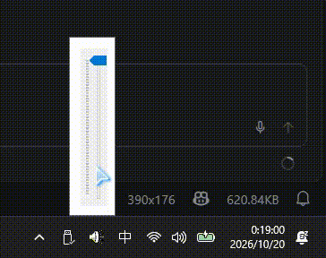

# Windows Class Volume Tray
Get tired of the Windows 11 volume tray? Get Windows 9x style tray back!



## Download
Go to [releases page](https://github.com/march1993/win-classic-volume-tray/releases)

## Disclaimer
The code is generated by AI using the following instruction,

```plain/text
帮我写一个Windows平台的golang程序，注册一个Windows 托盘tray图标，当点击时，出现一个滚动条，可以调整系统音量。注意，尽可能使用Windows api而不要依赖第三方库
```